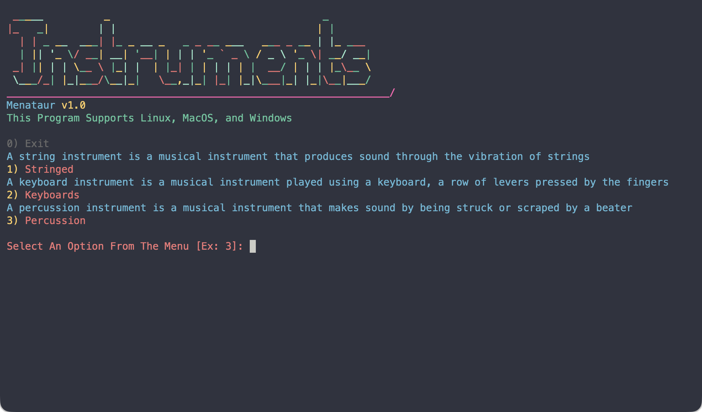

<p align="center">
  <a href="https://pypistats.org/packages/menataur"></a>
  <a href="https://www.python.org/downloads/"></a>
  <a href="https://opensource.org/licenses/MIT"></a>
</p>

# Description

Menataur is a python module for building simple menu interfaces for the terminal. It is super easy to use and makes constructing menu interfaces a breeze, turning hours, days, or even months of work into just a few minutes.

---

## Example Menu Interface Result

For more example images see [Images](Images/)

---

## Features

| Feature | Description |
|---------|-------------|
| **Well Structured** | Clean and organized API |
| **Highly Customizable** | Every Menu can be finely customized to meet your needs |
| **Support for Custom Input Prompts** | You can create custom prompts for every option to collect user data exactly as needed or just customize the main prompt if that's what you want/need |
| **Simple API** | Intuitive, easy-to-use, and object-oriented design |
| **Menu Navigation** | Built-in back-and-forth navigation between each Menu |
| **Great Color Support** | Multiple built-in colors with a way to add custom colors if needed |
| **Dependency Free** | Only uses Python's built-in libraries |

---

## Structure

| Component | Purpose |
|-----------|---------|
| **Banner** | Makes up the header section of a Menu object. |
| **Options** | Makes up the body section of a Menu object. |
| **Prompt** | Makes up the footer section of a Menu object. |
| **Menu** | Combines a Banner, Options, and Prompt(s) object(s) to make a Menu. |
| **Menataur** | Makes up a Menu Interface using a datamapped start_menu (must be a main menu) and handles the back-and-forth navigation between each Menu. |

## Installation

```bash
pip3 install menataur
```

## Example Usage

```python
import menataur

# [=== Special Menu Objects ===] #

# create instrument prompt
instrument_prompt = menataur.Prompt()
instrument_prompt.prompt_message_color = "light_cyan"
instrument_prompt.prompt_message = "Do you play this instrument? "

# special color
menataur.add_foreground_color("hot_pink", "\033[38;5;205m")

# [=== Test Menu 1 ===] #

# create Banner
banner_1 = menataur.Banner()

banner_1.title = r"""
 _____          _                                   _       
|_   _|        | |                                 | |      
  | | _ __  ___| |_ _ __ _   _ _ __ ___   ___ _ __ | |_ ___ 
  | || '_ \/ __| __| '__| | | | '_ ` _ \ / _ \ '_ \| __/ __|
 _| || | | \__ \ |_| |  | |_| | | | | | |  __/ | | | |_\__ \
 \___/_| |_|___/\__|_|   \__,_|_| |_| |_|\___|_| |_|\__|___/"""
banner_1.title_colors = ["cyan", "yellow", "green", "magenta"]
banner_1.title_bar = "_______________________________________________________________/"
banner_1.title_bar_color = "hot_pink"
banner_1.program_name = "Menataur"
banner_1.program_name_color = "blue"
banner_1.program_version_number = 1.0 
banner_1.program_version_number_color = "yellow"
banner_1.operating_system_support_message = "This Program Supports Linux, MacOS, and Windows"
banner_1.operating_system_support_message_color = "light_green"

# create Options
options_1 = menataur.Options()

options_1.option_description_color = "blue"
options_1.option_number_color = "yellow"
options_1.option_name_color = "magenta"
options_1.navigation_option_color = "gray"

options_1.add_option("A string instrument is a musical instrument that produces sound through the vibration of strings", 1, "Stringed")
options_1.add_option("A keyboard instrument is a musical instrument played using a keyboard, a row of levers pressed by the fingers", 2, "Keyboards")
options_1.add_option("A percussion instrument is a musical instrument that makes sound by being struck or scraped by a beater", 3, "Percussion")

# create Prompt
prompt_1 = menataur.Prompt()

prompt_1.prompt_message_color = "light_magenta"
prompt_1.prompt_message = "Select An Option From The Menu [Ex: 3]: "

# create Menu
menu_1 = menataur.Menu()

menu_1.name = "main_menu"
menu_1.main_menu = True

menu_1.add_banner(banner_1)
menu_1.add_options(options_1)
menu_1.add_prompt(prompt_1)

# [=== Test Menu 2 ===] #

# create Banner
banner_2 = menataur.Banner()

banner_2.title = r"""
 _____ _        _                      _ 
/  ___| |      (_)                    | |
\ `--.| |_ _ __ _ _ __   __ _  ___  __| |
 `--. \ __| '__| | '_ \ / _` |/ _ \/ _` |
/\__/ / |_| |  | | | | | (_| |  __/ (_| |
\____/ \__|_|  |_|_| |_|\__, |\___|\__,_|
                         __/ |           
                        |___/            """
banner_2.title_colors = ["cyan", "yellow", "green", "magenta"]
banner_2.title_bar = "_________________________________________________/"
banner_2.title_bar_color = "blue"
banner_2.program_name = "Stringed"
banner_2.program_name_color = "blue"
banner_2.program_version_number = 1.0 
banner_2.program_version_number_color = "yellow"
banner_2.operating_system_support_message = "This Program Supports Linux, MacOS, and Windows"
banner_2.operating_system_support_message_color = "light_green"

# create Options
options_2 = menataur.Options()

options_2.option_description_color = "blue"
options_2.option_number_color = "yellow"
options_2.option_name_color = "magenta"
options_2.navigation_option_color = "gray"

options_2.add_option("An string instrument played by strumming or plucking its strings", 1, "Guitar")
options_2.add_option("A small, high-pitched string instrument usually played with a bow", 2, "Violin")
options_2.add_option("A small, four-string instrument played by strumming or plucking", 3, "Ukulele")

# create Prompt
prompt_2 = menataur.Prompt()

prompt_2.prompt_message_color = "light_magenta"
prompt_2.prompt_message = "Select An Option From The Menu [Ex: 3]: "

# create Menu
menu_2 = menataur.Menu()

menu_2.name = "stringed_menu"

menu_2.add_banner(banner_2)
menu_2.add_options(options_2)
menu_2.add_prompts({
    0: [prompt_2],
    1: [instrument_prompt],
    2: [instrument_prompt],
    3: [instrument_prompt]
})

menu_2.final_menu = True

# [=== Test Menu 3 ===] #

# create Banner
banner_3 = menataur.Banner()

banner_3.title = r"""
 _   __           _                         _     
| | / /          | |                       | |    
| |/ /  ___ _   _| |__   ___   __ _ _ __ __| |___ 
|    \ / _ \ | | | '_ \ / _ \ / _` | '__/ _` / __|
| |\  \  __/ |_| | |_) | (_) | (_| | | | (_| \__ \
\_| \_/\___|\__, |_.__/ \___/ \__,_|_|  \__,_|___/
             __/ |                                
            |___/                                 """
banner_3.title_colors = ["cyan", "yellow", "green", "magenta"]
banner_3.title_bar = "_________________________________________________/"
banner_3.title_bar_color = "blue"
banner_3.program_name = "Keyboards"
banner_3.program_name_color = "blue"
banner_3.program_version_number = 1.0 
banner_3.program_version_number_color = "yellow"
banner_3.operating_system_support_message = "This Program Supports Linux, MacOS, and Windows"
banner_3.operating_system_support_message_color = "light_green"

# create Options
options_3 = menataur.Options()

options_3.option_description_color = "blue"
options_3.option_number_color = "yellow"
options_3.option_name_color = "magenta"
options_3.navigation_option_color = "gray"

options_3.add_option("A keyboard instrument that makes sound when hammers strike its strings", 1, "Piano")
options_3.add_option("A keyboard instrument that produces sound by sending air through pipes or electronic tone generators", 2, "Organ")
options_3.add_option("A keyboard instrument that produces a delicate, bell-like sound when hammers strike metal bars", 3, "Celeste")

# create Prompt
prompt_3 = menataur.Prompt()

prompt_3.prompt_message_color = "light_magenta"
prompt_3.prompt_message = "Select An Option From The Menu [Ex: 3]: "

# create Menu
menu_3 = menataur.Menu()

menu_3.name = "keyboards_menu"

menu_3.add_banner(banner_3)
menu_3.add_options(options_3)
menu_3.add_prompts({
    0: [prompt_3],
    1: [instrument_prompt],
    2: [instrument_prompt],
    3: [instrument_prompt]
})

menu_3.final_menu = True

# [=== Test Menu 4 ===] #

# create Banner
banner_4 = menataur.Banner()

banner_4.title = r"""
______                           _             
| ___ \                         (_)            
| |_/ /__ _ __ ___ _   _ ___ ___ _  ___  _ __  
|  __/ _ \ '__/ __| | | / __/ __| |/ _ \| '_ \ 
| | |  __/ | | (__| |_| \__ \__ \ | (_) | | | |
\_|  \___|_|  \___|\__,_|___/___/_|\___/|_| |_|"""
banner_4.title_colors = ["cyan", "yellow", "green", "magenta"]
banner_4.title_bar = "_________________________________________________/"
banner_4.title_bar_color = "blue"
banner_4.program_name = "Percussion"
banner_4.program_name_color = "blue"
banner_4.program_version_number = 1.0 
banner_4.program_version_number_color = "yellow"
banner_4.operating_system_support_message = "This Program Supports Linux, MacOS, and Windows"
banner_4.operating_system_support_message_color = "light_green"

# create Options
options_4 = menataur.Options()

options_4.option_description_color = "blue"
options_4.option_number_color = "yellow"
options_4.option_name_color = "magenta"
options_4.navigation_option_color = "gray"

options_4.add_option("A large drum that produces a deep, low sound when struck", 1, "Bass Drum")
options_4.add_option("A metal percussion instrument that makes a bright crash or ringing sound when struck", 2, "Cymbal")
options_4.add_option("Tall, single-headed hand drums played with the hands, often in pairs", 3, "Congas")

# create Prompt
prompt_4 = menataur.Prompt()

prompt_4.prompt_message_color = "light_magenta"
prompt_4.prompt_message = "Select An Option From The Menu [Ex: 3]: "

# create Menu
menu_4 = menataur.Menu()

menu_4.name = "percussion_menu"

menu_4.add_banner(banner_4)
menu_4.add_options(options_4)
menu_4.add_prompts({
    0: [prompt_4],
    1: [instrument_prompt],
    2: [instrument_prompt],
    3: [instrument_prompt]
})

menu_4.final_menu = True

# [=== Datamapping === ] #

main_menu_datamap = {
    1: menu_2,
    2: menu_3,
    3: menu_4
}

menu_1.datamap = main_menu_datamap

# [=== Menataur (menu interface) ===] #

# create a Menataur (menu interface)
menu_interface = menataur.Menataur()

# specify the start Menu
menu_interface.start_menu = menu_1

# run the Menataur (menu interface)
user_choices = menu_interface.run()

print(user_choices)
```

### support
If you would like to show your support for Menataur feel free to star this <a href="https://github.com/gratonic/menataur">repository</b> and spread the word. Thank you for your support!
